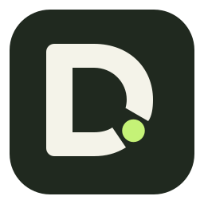

<div align="center">
  
  <h1>Discodex</h1>
  <p><strong>Native Windows Discord Rich Presence &amp; local usage analytics for AI coding tools.</strong></p>

  <p>
    <a href="https://github.com/braces157/discodex/actions/workflows/ci.yml"></a>
    <a href="https://github.com/braces157/discodex/releases/latest"></a>
    <a href="https://braces157.github.io/discodex/"></a>
    
    
  </p>

  <p>
    <a href="#highlights">Highlights</a> &middot;
    <a href="#usage-dashboard">Usage Dashboard</a> &middot;
    <a href="#provider-support">Providers</a> &middot;
    <a href="#installation">Install</a> &middot;
    <a href="#privacy">Privacy</a> &middot;
    <a href="#documentation">Docs</a>
  </p>
</div>

---

Discodex is a single-binary Windows tray application written in Rust that turns local AI coding activity into **Discord Rich Presence** and tracks **local model usage, cache hit rates, and API cost estimates** across 16 harnesses—without accounts, cloud sync, Electron, or telemetry.

It runs quietly in the notification area, recovers automatically when Discord or Explorer restarts, and enforces a strict local privacy boundary: normal activity never sends prompts, responses, raw commands, full paths, tool output, window titles, or usage totals to Discord.

## Highlights

| Capability | What it does |
| --- | --- |
| **39 provider targets** | Combines **21 rich session adapters** (project, language, current file basename, phase, elapsed time), **17 focused-app fallbacks**, and **1 activity-only adapter**. |
| **Native GPUI usage popup** | Click the tray icon for local token counts, logged calls, cache hit rates, daily charts, period &amp; provider filters, and base-rate API cost estimates across **16 harnesses**. |
| **Privacy by design** | Strips conversation content, paths, commands, and tool output before anything reaches local Discord IPC. Reasoning headings require explicit opt-in. |
| **Unified provider artwork** | 30 provider marks rebuilt onto a consistent 512px plate and hosted from this repository—no mismatched external hotlinks. |
| **Zero-dependency footprint** | Single native Windows `.exe` with automatic Discord reconnection, Explorer tray recovery, startup toggle, and CLI lifecycle controls. |
| **Built-in diagnostics** | One-click local snapshot of detected providers, store access, watcher state, and Discord connection health without exposing paths or session contents. |

## Usage Dashboard

Click the Discodex tray icon—or run `discodex --usage` standalone—to open a compact native **GPUI** popup tracking local usage across **16 harnesses**:

> **Codex** (including `.jsonl.zst` archives) &middot; **Claude Code** &middot; **Google Antigravity** &middot; **DeepSeek Harness** &middot; **Gemini CLI** &middot; **Qwen Code** &middot; **OpenCode** &middot; **Kilo Code** &middot; **Factory Droid** &middot; **GitHub Copilot CLI** &middot; **Junie** &middot; **Cline** &middot; **Roo Code** &middot; **Zed** &middot; **Crush** &middot; **Aider**

- **Normalized totals:** Cached input and reasoning output are normalized to inclusive totals once across every store format (JSONL, Zstandard, JSON, Markdown, SQLite + `-wal`) so subsets are never double-counted.
- **Interactive filters &amp; charts:** Filter summary cards, daily bar charts (`Tokens`, `Cost`, `Calls`), and model/effort rows by time period (`Today`, `7d`, `30d`, `All`) and by provider.
- **Automatic official pricing:** Bundles a Standard API base-rate catalog (checked `2026-11-19`) covering OpenAI, Claude, Google Gemini, DeepSeek, and Qwen, with per-provider/model overrides in `%APPDATA%\Discodex\usage-rates.toml`.
- **100% local:** Opens no network listener, makes no API calls, and never sends usage totals or costs to Discord.

See [docs/USAGE.md](docs/USAGE.md) for full details on storage schemas, pricing sources, normalization rules, and custom rate overrides.

## Provider Support

Discodex pairs **rich local session adapters** (reading structured local logs and SQLite stores) with **focused-app detection** for broad compatibility across editors, terminals, and web apps.

- **21 Rich session adapters:** OpenAI Codex, Claude Code, Google Antigravity, DeepSeek Harness, Gemini CLI, Qwen Code, GitHub Copilot CLI, Factory Droid, Kiro, Cursor, Windsurf / Cascade, Junie (JetBrains), Aider, Cline, Roo Code, Continue, Block Goose, Charm Crush, OpenCode, Zed, Kilo Code.
- **17 Focused-app targets:** ChatGPT, Claude, Google Gemini, Cursor, Windsurf, Trae, Kiro, Zed AI, OpenCode, Aider, GitHub Copilot, Cline, Roo Code, Continue, Perplexity, Microsoft Copilot, Poe.
- **1 Activity-only adapter:** Sourcegraph Amp.

<details>
<summary><strong>View full 39-target provider matrix</strong></summary>

| Provider | Detection source | Detail level |
| --- | --- | --- |
| OpenAI Codex | Local session JSONL / `.jsonl.zst` | Rich |
| Claude Code | Local session JSONL | Rich |
| Google Antigravity | Local session JSONL | Rich |
| DeepSeek Harness | Local JSONL / Zstandard session logs | Rich |
| Gemini CLI | Local JSON / JSONL session logs | Rich |
| Qwen Code | Local JSONL session logs | Rich |
| GitHub Copilot CLI | Local JSONL session events | Rich |
| Factory Droid | Local JSONL / settings session logs | Rich |
| Kiro | Local JSONL session transcripts | Rich |
| Cursor | Local JSONL agent transcripts | Rich |
| Windsurf / Cascade | Local JSONL transcripts | Rich |
| Junie (JetBrains) | Local JSONL session events | Rich |
| Aider | Local Markdown transcript | Rich |
| Cline | Local JSON session documents | Rich |
| Roo Code | Local JSON session documents | Rich |
| Continue | Local JSON session documents | Rich |
| Block Goose | Local SQLite session database | Rich |
| Charm Crush | Local SQLite session database | Rich |
| OpenCode | Local SQLite session database | Rich |
| Zed | Local SQLite thread database | Rich |
| Kilo Code | Local SQLite session database | Rich |
| Sourcegraph Amp | Local JSONL thread log | Activity only |
| ChatGPT | Focused app / window | Standard |
| Claude | Focused app / window | Standard |
| Google Gemini | Focused app / window | Standard |
| Cursor | Focused app / window | Standard |
| Windsurf | Focused app / window | Standard |
| Trae | Focused app / window | Standard |
| Kiro | Focused app / window | Standard |
| Zed AI | Focused app / window | Standard |
| OpenCode | Focused app / window | Standard |
| Aider | Focused app / window | Standard |
| GitHub Copilot | Focused app / window | Standard |
| Cline | Focused app / window | Standard |
| Roo Code | Focused app / window | Standard |
| Continue | Focused app / window | Standard |
| Perplexity | Focused app / window | Standard |
| Microsoft Copilot | Focused app / window | Standard |
| Poe | Focused app / window | Standard |

</details>

See [docs/PROVIDERS.md](docs/PROVIDERS.md) for detection internals and [docs/ARTWORK.md](docs/ARTWORK.md) for the provider artwork pipeline.

## Installation

### Download a release (recommended)

1. Download `discodex.exe` from the [latest GitHub release](https://github.com/braces157/discodex/releases/latest).
2. Run `discodex.exe`—no installer required. Discodex creates its config automatically and settles into the Windows tray.
3. Keep Discord Desktop running; Discodex connects and reconnects automatically.

Only one Discodex tray instance runs per Windows session.

### Build from source

**Requirements:**
- Windows 10 or Windows 11
- Rust **1.89** or newer
- Windows SDK shader compiler `fxc.exe` on `PATH` or via `GPUI_FXC_PATH` *(if `where.exe fxc.exe` returns multiple paths, set `GPUI_FXC_PATH` to a single full executable path—GPUI 0.2.2 otherwise treats combined output as one executable)*
- Discord Desktop for Rich Presence output

```powershell
git clone https://github.com/braces157/discodex.git
cd discodex
cargo test
cargo build --release
```

The release binary is written to `target\release\discodex.exe`. To embed a custom Discord application ID at build time:

```powershell
$env:DISCODEX_DISCORD_APPLICATION_ID = "YOUR_APPLICATION_ID"
cargo build --release
```

### CLI &amp; lifecycle management

```powershell
discodex --usage          # Open the GPUI Usage Dashboard standalone
discodex --diagnostics    # Print a standalone local diagnostics snapshot
discodex --restart        # Cleanly restart (alias: --replace)
discodex --quit           # Stop the running tray instance (alias: --stop)
```

You can also manage local builds and installs with `tools/discodex.ps1`:
- `start | stop | restart | status` — control the tray process
- `deploy` — build and install from a checkout
- `install` — configure Start Menu and `PATH` integration for an installed binary

## Tray Controls &amp; Configuration

Right-click the tray icon to toggle presence, focused-app fallback, startup with Windows, privacy switches (**Share reasoning**, **Show project names**, **Show file names**), **Usage Dashboard**, **Diagnostics**, **Open Config**, **Restart**, and **Exit**.

Configuration lives at `%APPDATA%\Discodex\config.toml`:

```toml
discord_application_id = ""
enabled = true
start_with_windows = false
foreground_detection = true

[privacy]
share_reasoning = false
show_project_names = true
show_file_names = true
```

- `share_reasoning` is **off by default** (including across upgrades).
- Hiding project or file names also suppresses opted-in reasoning headings so names cannot leak indirectly.
- Setting `discord_application_id` overrides the build-time default; leave it empty to use the embedded ID.

See [docs/CONFIGURATION.md](docs/CONFIGURATION.md) for every setting.

## Privacy

Discodex enforces a strict boundary between local session inspection and what reaches local Discord IPC:

| May be sent to Discord | Never leaves your machine |
| --- | --- |
| Provider name &amp; artwork | Prompts &amp; assistant responses |
| Workspace folder name *(toggleable)* | Full file paths &amp; environment variables |
| Current file basename *(toggleable)* | Raw shell commands, tool args &amp; tool output |
| Inferred language / framework | Window titles &amp; browser URLs |
| Normalized activity label, phase &amp; elapsed time | Session contents &amp; account identifiers |
| Opted-in reasoning heading *(off by default)* | Usage totals, token counts &amp; API cost estimates |

Read the full privacy model in [docs/PRIVACY.md](docs/PRIVACY.md).

## Documentation

| Guide | Topic |
| --- | --- |
| [docs/USAGE.md](docs/USAGE.md) | GPUI usage dashboard, 16 harnesses, normalization, pricing catalog &amp; overrides |
| [docs/PROVIDERS.md](docs/PROVIDERS.md) | Rich session adapters vs. focused-app detection across all 39 targets |
| [docs/PRIVACY.md](docs/PRIVACY.md) | Data boundary, opt-in controls, and threat model |
| [docs/CONFIGURATION.md](docs/CONFIGURATION.md) | Runtime TOML settings, environment variables, and diagnostics |
| [docs/INSTALLATION.md](docs/INSTALLATION.md) | Release installation, Windows startup, and building from source |
| [docs/ARCHITECTURE.md](docs/ARCHITECTURE.md) | Crate layout, ingestion, scheduling, and Discord IPC flow |
| [docs/ARTWORK.md](docs/ARTWORK.md) | 512px provider mark set and rebuild pipeline |
| [docs/TROUBLESHOOTING.md](docs/TROUBLESHOOTING.md) | Common Discord IPC, tray, and build issues |
| [CONTRIBUTING.md](CONTRIBUTING.md) · [SECURITY.md](SECURITY.md) · [CHANGELOG.md](CHANGELOG.md) | Contributing guidelines, security policy, and release history |

## Development

Run the full CI verification suite locally before opening a pull request:

```powershell
cargo fmt --check
cargo clippy --all-targets -- -D warnings
cargo test
cargo build --release
```
